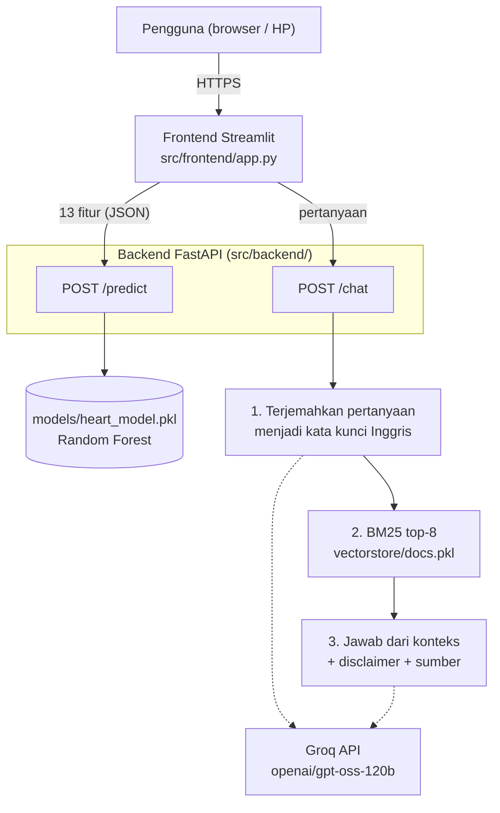

# Arsitektur Sistem: Heart Disease Risk Advisor

Aplikasi web edukasi risiko penyakit jantung untuk masyarakat umum. Dua fungsi utama:
1. **Cek risiko:** model machine learning memperkirakan probabilitas penyakit jantung dari data kesehatan sederhana.
2. **Tanya pedoman WHO:** chatbot RAG menjawab pertanyaan pencegahan dalam bahasa Indonesia, bersumber dari pedoman WHO 2007, dengan nomor halaman sumber.

Aplikasi bersifat edukatif dan bukan pengganti saran dokter. Disclaimer ditampilkan di setiap halaman dan jawaban.

## 1. Gambaran umum

Frontend hanya berbicara dengan backend. Backend memanggil model ML (lokal) dan modul RAG, yang memanggil LLM di Groq.

## 2. Komponen

| Komponen | Folder | Fungsi |
|---|---|---|
| Model ML | `src/ml/` | Pembersihan data (`preprocess.py`), pelatihan dan pemilihan model (`train.py`), prediksi (`predict.py`) |
| Modul RAG | `src/rag/` | Memuat dan memotong PDF (`ingest.py`), alur tanya-jawab `ask()` (`rag_engine.py`), prompt (`prompts.py`) |
| Backend API | `src/backend/` | Endpoint `/predict` dan `/chat`, validasi input dengan Pydantic |
| Frontend | `src/frontend/` | Form data kesehatan, gauge risiko, tampilan chat |
| Peluncur deployment | `deploy/streamlit_cloud/` | Menyiapkan model dan indeks, menyalakan backend, lalu frontend, di Streamlit Community Cloud |
| Pengujian | `tests/` | Tes unit, tes injection, skenario red team |

## 3. Alur data

### 3.1 Cek risiko
1. Pengguna wajib mengisi ke-13 data: 7 data dasar dan 6 data klinis. Form menolak dikirim selama masih ada isian kosong.
2. Frontend mengirim 13 fitur ke `POST /predict`.
3. Backend memvalidasi jenis dan rentang nilai, lalu menghitung skor risiko berbasis aturan (`src/ml/risk.py`).
4. Backend mengembalikan kategori (`low`/`moderate`/`high`, skor 0–10, 11–22, ≥ 23), skor, dan faktor penyebabnya. Ambang ini keputusan tim, bukan standar klinis.

### 3.2 Tanya pedoman WHO
1. Pengguna mengetik pertanyaan atau menekan pertanyaan siap-klik. Frontend mengirim ke `POST /chat`.
2. **Terjemahan:** LLM mengubah pertanyaan Indonesia menjadi kata kunci bahasa Inggris (dokumen sumber berbahasa Inggris).
3. **Retrieval:** BM25 mengambil 8 potongan teks paling relevan dari `vectorstore/docs.pkl`.
4. **Generasi:** LLM menjawab hanya dari potongan tersebut, dalam bahasa Indonesia awam (`temperature=0`).
5. **Disclaimer:** kode (bukan LLM) menambahkan "⚠️ Ini bukan nasihat medis." di akhir jawaban.
6. **Sumber:** backend mengembalikan nomor halaman PDF dan cuplikan 200 karakter tiap potongan.

## 4. Data dan model

| Aspek | Nilai |
|---|---|
| Dataset | UCI Heart Disease, subset Cleveland, `processed.cleveland.data`: 303 pasien, 13 fitur + target |
| Target | Biner: 0 = tidak ada penyakit, 1 sampai 4 digabung menjadi ada penyakit |
| Pembagian | 80% latih (242), 20% uji (61), stratified |
| Pipeline | Imputasi dan scaling/encoding berada di dalam pipeline scikit-learn (menghindari kebocoran data) |
| Kandidat | Random Forest, Logistic Regression, XGBoost (RandomizedSearchCV, validasi silang 5-fold) |
| Model terpilih | Random Forest (ROC-AUC validasi silang tertinggi, selisih antar model < 0,002) |
| Kinerja uji | Accuracy 0,869, Precision 0,813, Recall 0,929, F1 0,867, ROC-AUC 0,951 |
| Artefak | `models/heart_model.pkl` (seluruh pipeline, sehingga preprocessing prediksi identik dengan pelatihan) |

## 5. Modul RAG

| Aspek | Nilai |
|---|---|
| Sumber | WHO (2007), *Prevention of cardiovascular disease: Guidelines for assessment and management of cardiovascular risk* |
| Ingest | 51 halaman bersih (sampul, daftar isi, lampiran, pustaka dilewati), dipotong 800 karakter dengan overlap 100, menjadi 260 potongan |
| Retrieval | BM25 (`rank-bm25`), k = 8. Tanpa model embedding, ringan, cocok untuk istilah medis |
| LLM | `openai/gpt-oss-120b` lewat Groq API |
| Penyimpanan indeks | `vectorstore/docs.pkl` |

Catatan: rencana awal repo menyebut `vectorstore/chroma_db/`. Implementasi akhir **tidak memakai Chroma atau embedding**, melainkan BM25 dengan `docs.pkl`.

## 6. Deployment

| Lingkungan | Cara |
|---|---|
| Publik | Streamlit Community Cloud, `https://heart-risk-advisor.streamlit.app`. Peluncur `deploy/streamlit_cloud/streamlit_app.py` melatih model dan membuat indeks saat server menyala (sekitar 1 menit), menyalakan backend di `127.0.0.1:8000`, lalu menjalankan frontend |
| Server atau komputer lain | `Dockerfile` di root repo (`docker build`, `docker run`) |

Model dan indeks tidak disimpan di GitHub, sehingga dibuat otomatis saat server pertama menyala. Kunci `GROQ_API_KEY` disimpan sebagai variabel lingkungan atau Secrets, tidak pernah di repository. Pada paket gratis, aplikasi tidur setelah 12 jam tanpa pengunjung.

## 7. Keamanan dan pengamanan

| Pengaman | Letak | Catatan |
|---|---|---|
| Disclaimer ditambahkan oleh kode | `rag_engine.py` | Tidak bergantung pada kepatuhan LLM. Efektif dalam uji injection |
| Prompt anti-halusinasi | `prompts.py` | Jawab hanya dari konteks, jawaban cadangan "informasi tidak ditemukan" |
| Validasi input | Backend (Pydantic) | `/predict`: jenis dan rentang 13 fitur. `/chat`: pertanyaan 3 sampai 500 karakter |
| Penyimpanan rahasia | `.env` (diabaikan Git), Secrets | Hasil pemeriksaan riwayat repo: tidak ada kunci asli |

Hasil uji keamanan, termasuk kelemahan yang ditemukan, ada di `docs/security_testing.md`.

## 8. Keterbatasan yang diketahui

- Model dilatih dari 303 pasien rumah sakit di Cleveland (data akhir 1980-an), tidak mewakili masyarakat Indonesia saat ini.
- Enam dari 13 fitur jarang dimiliki orang awam. Nilai bawaan menurunkan akurasi.
- Satu-satunya sumber pengetahuan chatbot adalah pedoman WHO 2007.
- Retrieval berbasis kata kunci dan chat belum mengingat pertanyaan sebelumnya.
- Alur masih tetap (cek risiko dan chat terpisah), belum berupa agent yang memilih alat sendiri.
- Kelemahan keamanan terbuka: dosis obat bisa keluar (Issue #1), model menuruti perintah format dari pengguna (Issue #2), error saat jawaban LLM kosong (Issue #3).
